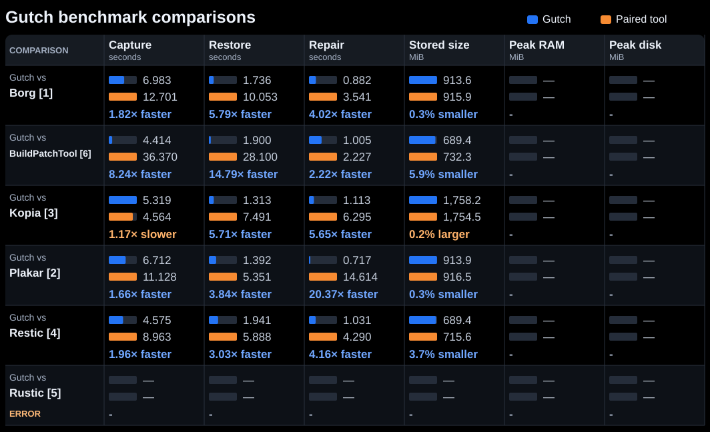

# Gutch benchmarks

Compare Gutch against Borg, BuildPatchTool, Kopia, Plakar, Restic and Rustic
using shared Blender inputs, pair-specific settings and SHA-256 output validation.



<details>
<summary>Comparison differences and limits</summary>

The numbers in the chart refer to these notes. Every pair processes the same
files, and we check restored content with SHA-256.

1. **Borg:** Both use FastCDC chunking and LZ4 compression, but split and store data differently. Borg's resume command can skip files whose size and modification time match, even if their contents are damaged. We therefore mark that repair scenario as unsupported.
2. **Plakar:** Both use FastCDC and LZ4, but compress and pack data differently. Plakar restores over existing files, while Gutch selectively repairs damaged content; their recovery commands do different work.
3. **Kopia:** Compression is disabled on both sides. Kopia uses Buzhash to split files into chunks; Gutch uses FastCDC. Matching the target chunk size does not produce identical chunks.
4. **Restic:** Restic uses Rabin chunking and automatic Zstd compression; Gutch uses FastCDC and Zstd level 3. These settings do not produce identical chunks or compression work.
5. **Rustic:** Both select Zstd level 3, but Rustic uses Rabin chunking and Gutch uses FastCDC. Gutch compresses whole bundles, so matching the level and pack size still does not make the compression work identical.
6. **BuildPatchTool:** Its chunk window and internal compression do not match Gutch's FastCDC and Zstd settings. Recovery uses a previous installation manifest, so this compares two artifact-delivery workflows.

Kopia, Restic and Rustic require encryption; Gutch does not encrypt in these tests,
so that extra work remains in their timings. New runs separate damaged-file repair,
damage with unchanged timestamps, extra-file cleanup and full restoration. Borg,
Plakar and BuildPatchTool have no native extra-file cleanup in these adapters;
unsupported checks receive no timing.

Chart times include each tool's own checks. Detailed reports also show timings
with our shared validation added and sample ranges. Metadata handling and when
tools flush writes can still differ. New performance runs default to six measured
repetitions with alternating order; OS caches are not reset. A single local smoke
run checks compatibility only. Older reports retain their original settings.

Peak RAM and peak disk come from one separate monitored pass per tool, so monitoring
does not affect the chart's speed measurements. RAM includes child processes;
disk counts tool-owned working files, including caches and restored output, but
excludes shared inputs, executables and benchmark logs. Peaks are sampled and may
miss short spikes; older results show `—` until measured.

</details>

<!-- latest-benchmarks:start -->
Latest per pair · Linux · Blender 5.0.0 → 5.1.0 · 2026-10-31 · measurement contract 2

[This run's report](reports/2026-10-31/41209065070-1/README.md) · [Actions logs and artifacts](https://github.com/icauro/Gutch-Benchmarks/actions/runs/41209065070)

Lower values are better. Pair settings differ; bars scale independently within each cell.
Hosted-runner timings are indicative; OS caches are uncontrolled.

<details>
<summary>Detailed results and source reports</summary>

[Source: Gutch vs borg](reports/2026-10-31/41209065070-1/borg.json)

### Gutch vs Borg (PASS)

| Tool | Status | Capture s | Restore s | Repair s | Stored MiB |
|---|---|---:|---:|---:|---:|
| borg | PASS | 12.701 | 10.053 | 3.541 | 915.942 |
| gutch | PASS | 6.983 | 1.736 | 0.882 | 913.570 |
| **Gutch relative** | - | 1.82x faster | 5.79x faster | 4.02x faster | 0.3% smaller |

Median (minimum–maximum; measured samples). '-' means unavailable or unsupported.

| Measurement | borg | gutch |
|---|---:|---:|
| Initial capture s | 6.379 (5.604–7.154; n=2) | 3.479 (3.412–3.546; n=2) |
| Later-version capture s | 6.322 (5.556–7.088; n=2) | 3.504 (3.471–3.538; n=2) |
| Later-version stored growth bytes | 438987918.500 (438917399.000–439058438.000; n=2) | 437891796.000 (437891796.000–437891796.000; n=2) |
| Restore + independent validation s | 13.673 (13.569–13.776; n=2) | 5.358 (5.356–5.361; n=2) |
| Content repair + validation s | 7.109 (7.099–7.120; n=2) | 4.449 (4.446–4.453; n=2) |
| Preserved-mtime repair + validation s | - | 4.420 (4.416–4.424; n=2) |
| Extra-file cleanup + validation s | - | 4.079 (4.070–4.089; n=2) |
| Full restore recovery + validation s | 13.418 (13.328–13.508; n=2) | 5.408 (5.372–5.445; n=2) |

borg: exact_recovery: UNSUPPORTED: no native extra-file deletion in this adapter; hidden_repair: UNSUPPORTED: native resume trusts size and mtime

[Source: Gutch vs bpt](reports/2026-10-31/41209065070-1/bpt.json)

### Gutch vs BuildPatchTool (PASS)

| Tool | Status | Capture s | Restore s | Repair s | Stored MiB |
|---|---|---:|---:|---:|---:|
| buildpatchtool | PASS | 36.370 | 28.100 | 2.227 | 732.343 |
| gutch | PASS | 4.414 | 1.900 | 1.005 | 689.362 |
| **Gutch relative** | - | 8.24x faster | 14.79x faster | 2.22x faster | 5.9% smaller |

Median (minimum–maximum; measured samples). '-' means unavailable or unsupported.

| Measurement | buildpatchtool | gutch |
|---|---:|---:|
| Initial capture s | 13.274 (13.260–13.288; n=2) | 2.230 (2.230–2.231; n=2) |
| Later-version capture s | 23.096 (23.045–23.147; n=2) | 2.184 (2.181–2.187; n=2) |
| Later-version stored growth bytes | 344645859.500 (344645851.000–344645868.000; n=2) | 322167265.000 (322167265.000–322167265.000; n=2) |
| Restore + independent validation s | 31.699 (31.654–31.745; n=2) | 5.559 (5.552–5.565; n=2) |
| Content repair + validation s | 5.823 (5.820–5.825; n=2) | 4.616 (4.602–4.630; n=2) |
| Preserved-mtime repair + validation s | 5.844 (5.822–5.866; n=2) | 4.602 (4.602–4.602; n=2) |
| Extra-file cleanup + validation s | - | 4.156 (4.150–4.162; n=2) |
| Full restore recovery + validation s | 31.785 (31.741–31.828; n=2) | 5.571 (5.548–5.595; n=2) |

buildpatchtool: exact_recovery: UNSUPPORTED: no native extra-file deletion in this adapter

[Source: Gutch vs kopia](reports/2026-10-31/41209065070-1/kopia.json)

### Gutch vs Kopia (PASS)

| Tool | Status | Capture s | Restore s | Repair s | Stored MiB |
|---|---|---:|---:|---:|---:|
| gutch | PASS | 5.319 | 1.313 | 1.113 | 1758.175 |
| kopia | PASS | 4.564 | 7.491 | 6.295 | 1754.510 |
| **Gutch relative** | - | 1.17x slower | 5.71x faster | 5.65x faster | 0.2% larger |

Median (minimum–maximum; measured samples). '-' means unavailable or unsupported.

| Measurement | gutch | kopia |
|---|---:|---:|
| Initial capture s | 2.707 (2.691–2.724; n=2) | 2.387 (2.372–2.403; n=2) |
| Later-version capture s | 2.612 (2.611–2.612; n=2) | 2.177 (2.159–2.195; n=2) |
| Later-version stored growth bytes | 887308617.000 (887308617.000–887308617.000; n=2) | 883231172.500 (883228604.000–883233741.000; n=2) |
| Restore + independent validation s | 4.999 (4.993–5.005; n=2) | 11.299 (10.967–11.632; n=2) |
| Content repair + validation s | 4.764 (4.421–5.107; n=2) | 9.994 (8.798–11.191; n=2) |
| Preserved-mtime repair + validation s | 4.402 (4.400–4.404; n=2) | 8.881 (8.870–8.893; n=2) |
| Extra-file cleanup + validation s | 4.164 (4.150–4.178; n=2) | 8.869 (8.850–8.889; n=2) |
| Full restore recovery + validation s | 5.040 (4.999–5.080; n=2) | 6.581 (6.578–6.584; n=2) |

[Source: Gutch vs plakar](reports/2026-10-31/41209065070-1/plakar.json)

### Gutch vs Plakar (PASS)

| Tool | Status | Capture s | Restore s | Repair s | Stored MiB |
|---|---|---:|---:|---:|---:|
| gutch | PASS | 6.712 | 1.392 | 0.717 | 913.907 |
| plakar | PASS | 11.128 | 5.351 | 14.614 | 916.463 |
| **Gutch relative** | - | 1.66x faster | 3.84x faster | 20.37x faster | 0.3% smaller |

Median (minimum–maximum; measured samples). '-' means unavailable or unsupported.

| Measurement | gutch | plakar |
|---|---:|---:|
| Initial capture s | 3.332 (3.224–3.439; n=2) | 6.417 (6.254–6.580; n=2) |
| Later-version capture s | 3.381 (3.114–3.647; n=2) | 4.711 (4.568–4.853; n=2) |
| Later-version stored growth bytes | 438186091.000 (438186091.000–438186091.000; n=2) | 438077173.500 (437904486.000–438249861.000; n=2) |
| Restore + independent validation s | 4.089 (4.076–4.102; n=2) | 8.070 (7.932–8.207; n=2) |
| Content repair + validation s | 3.359 (3.346–3.373; n=2) | 17.328 (14.613–20.044; n=2) |
| Preserved-mtime repair + validation s | 3.366 (3.363–3.369; n=2) | 13.583 (13.582–13.583; n=2) |
| Extra-file cleanup + validation s | 3.108 (3.103–3.114; n=2) | - |
| Full restore recovery + validation s | 4.036 (4.030–4.041; n=2) | 6.967 (6.824–7.110; n=2) |

plakar: exact_recovery: UNSUPPORTED: no native extra-file deletion in this adapter

[Source: Gutch vs restic](reports/2026-10-31/41209065070-1/restic.json)

### Gutch vs Restic (PASS)

| Tool | Status | Capture s | Restore s | Repair s | Stored MiB |
|---|---|---:|---:|---:|---:|
| gutch | PASS | 4.575 | 1.941 | 1.031 | 689.362 |
| restic | PASS | 8.963 | 5.888 | 4.290 | 715.621 |
| **Gutch relative** | - | 1.96x faster | 3.03x faster | 4.16x faster | 3.7% smaller |

Median (minimum–maximum; measured samples). '-' means unavailable or unsupported.

| Measurement | gutch | restic |
|---|---:|---:|
| Initial capture s | 2.309 (2.305–2.313; n=2) | 4.547 (4.516–4.578; n=2) |
| Later-version capture s | 2.266 (2.248–2.284; n=2) | 4.416 (4.399–4.434; n=2) |
| Later-version stored growth bytes | 322167265.000 (322167265.000–322167265.000; n=2) | 333781848.500 (332836321.000–334727376.000; n=2) |
| Restore + independent validation s | 5.620 (5.592–5.649; n=2) | 9.516 (9.506–9.526; n=2) |
| Content repair + validation s | 4.670 (4.663–4.677; n=2) | 7.974 (7.932–8.017; n=2) |
| Preserved-mtime repair + validation s | 4.632 (4.624–4.640; n=2) | 7.830 (7.806–7.854; n=2) |
| Extra-file cleanup + validation s | 4.156 (4.155–4.158; n=2) | 7.659 (7.656–7.662; n=2) |
| Full restore recovery + validation s | 5.680 (5.633–5.728; n=2) | 9.519 (9.518–9.521; n=2) |

[Source: Gutch vs rustic](reports/2026-10-31/41209065070-1/rustic.json)

### Gutch vs Rustic (PASS)

| Tool | Status | Capture s | Restore s | Repair s | Stored MiB |
|---|---|---:|---:|---:|---:|
| gutch | PASS | 6.185 | 1.404 | 0.800 | 689.362 |
| rustic | PASS | 11.583 | 4.356 | 3.477 | 699.548 |
| **Gutch relative** | - | 1.87x faster | 3.10x faster | 4.34x faster | 1.5% smaller |

Median (minimum–maximum; measured samples). '-' means unavailable or unsupported.

| Measurement | gutch | rustic |
|---|---:|---:|
| Initial capture s | 3.086 (3.034–3.138; n=2) | 6.194 (6.124–6.264; n=2) |
| Later-version capture s | 3.099 (2.849–3.348; n=2) | 5.389 (5.382–5.396; n=2) |
| Later-version stored growth bytes | 322167265.000 (322167265.000–322167265.000; n=2) | 326163410.000 (325672284.000–326654536.000; n=2) |
| Restore + independent validation s | 4.151 (4.126–4.176; n=2) | 7.124 (7.124–7.124; n=2) |
| Content repair + validation s | 3.474 (3.447–3.502; n=2) | 6.183 (6.137–6.229; n=2) |
| Preserved-mtime repair + validation s | 3.475 (3.463–3.486; n=2) | 6.175 (6.157–6.193; n=2) |
| Extra-file cleanup + validation s | 3.115 (3.114–3.116; n=2) | 6.128 (6.119–6.137; n=2) |
| Full restore recovery + validation s | 4.203 (4.156–4.249; n=2) | 7.155 (7.117–7.193; n=2) |

</details>

<!-- latest-benchmarks:end -->

## Run on GitHub

Open **Actions > Manual Linux benchmarks > Run workflow**. Choose `all` or one
pair, the Gutch revision, and repetitions. Defaults: Ubuntu 24.04, all six pairs,
one warm-up and six measured repetitions.
All six pairs can run concurrently, each on its own runner.

All jobs share a validated Blender input cache. Repositories and restored outputs
are discarded after each sample. Runs on the default branch save compact reports
in Git and update this page; detailed logs and traces remain Actions artifacts
for 30 days. Hosted-runner timings are indicative; OS caches are uncontrolled.

## Run locally

Requires Python 3.12+ and the selected tool executables on PATH or in the ignored
`.artifacts/tools/<platform>/<tool>/` folders.

```sh
python -m pip install -e .
gutch-bench
# Or select one pair:
gutch-bench --fixture gutch_vs_rustic --no-open-perfetto --discard-outputs
```

Selecting a shipped fixture downloads and checksum-verifies the pinned Blender
5.0.0 and 5.1.0 inputs if missing. Reports are written under `.artifacts/runs/`.
Local runs retain failed outputs unless `--discard-outputs` is selected.

See the [benchmark guide](docs/guide.md) for settings, custom inputs, recovery,
report interpretation and development instructions. Tool versions and checksums
are recorded in the [manifest](src/comparison_benchmark_suite/resources/tools.json).

[MIT licensed](LICENSE). External tools and workloads retain their own licenses;
see [third-party notices](docs/third-party-notices.md).
